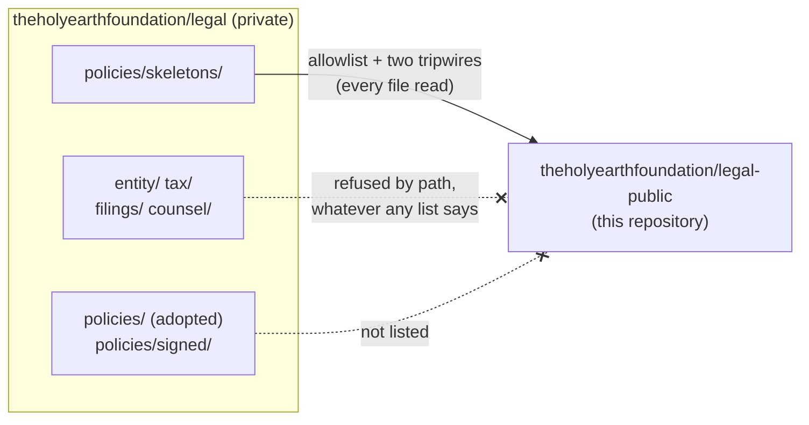

<picture>
  <source media="(prefers-color-scheme: dark)" srcset="https://raw.githubusercontent.com/theholyearthfoundation/.github/main/profile/assets/banner-dark.svg">
  
</picture>

# The Holy Earth Foundation: legal, the public lane

*How The Holy Earth Foundation keeps its paperwork, shown in the open: the folder map and the skeletons of the
policies it is writing. The paperwork itself stays private.*

##  What this is

The foundation keeps its legal paperwork in one **private** repository, `theholyearthfoundation/legal` (officers and
counsel only; a visitor who opens that link sees a 404). This public repository is its **witness**: a workflow copies
into it only the policy skeletons and their icons, after a check that reads every file, and nobody edits it by hand.

##  The folder map (private side)

| | Folder | What it holds | Here? |
|---|---|---|---|
|  | `entity/` | formation papers, bylaws, state registrations, the officer roster | never |
|  | `tax/` | returns and their working papers, by year | never |
|  | `filings/` | what is sent to or received from a government that is not a tax return | never |
|  | `counsel/` | questions for a CPA or an attorney, and their answers | never |
|  | `policies/` | the policies the foundation holds itself to | only [`policies/skeletons/`](policies/skeletons/) |

##  The policy skeletons

Headings and plain questions for the foundation's officers and counsel. **None is an adopted policy, and none states a
fact about The Holy Earth Foundation.** *Not legal advice.*

| | Skeleton |
|---|---|
|  | [Conflict of interest](policies/skeletons/conflict-of-interest.md) |
|  | [Gift acceptance](policies/skeletons/gift-acceptance.md) |
|  | [Treasury and digital assets](policies/skeletons/treasury-and-digital-assets.md) |
|  | [Document retention](policies/skeletons/document-retention.md) |

##  Please do not edit this repository by hand

Everything except this README is copied in by a workflow in the private repository, and the next copy replaces hand
edits. The rule it follows: *a public lane never publishes a file a machine or a person has not read.* The procedure is
SOP-OPS-003 in the foundation's procedures ([public twin](https://github.com/theholyearthfoundation/ops-standard-operating-procedures-public)).

The Holy Earth Foundation · [theholyearthfoundation.github.io](https://theholyearthfoundation.github.io) · [on GitHub](https://github.com/theholyearthfoundation) · Icons: Lucide (ISC) · Prepared 2026-11-01.
